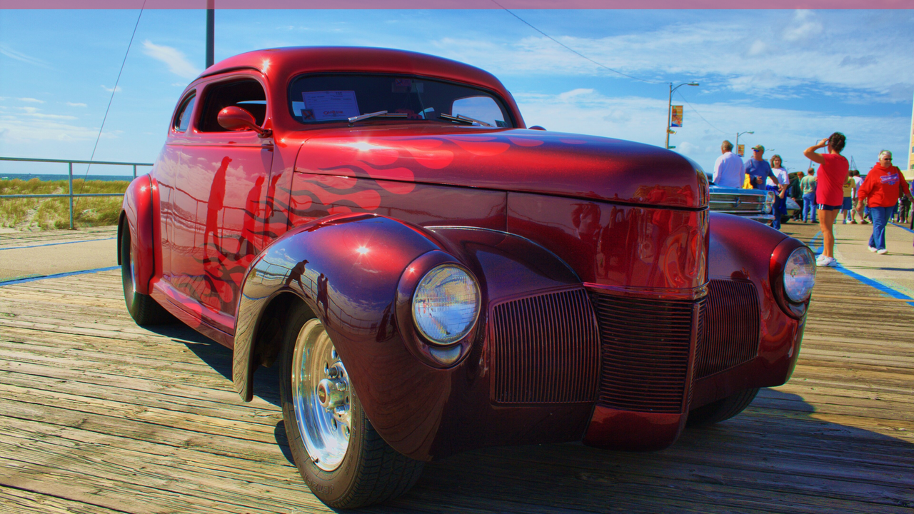

# Sidewinder

A dark Omarchy theme built from 1940 Ford Deluxe coupe street rod in candy-apple red over black.



## What it is

Candy-apple red over black, from a Ford Deluxe coupe built as a street rod: deep oxblood paint, chrome, and a black engine bay. The quietest theme in the collection, built for long sessions.

## Install

```bash
omarchy theme install https://github.com/offback/omarchy-sidewinder-theme.git
# or, from a local clone:
cp -r omarchy-sidewinder-theme ~/.config/omarchy/themes/
omarchy theme set sidewinder
```

## Palette

| Key | Value | |
|---|---|---|
| accent | `#d9536a` | the paint colour |
| background | `#211012` | |
| foreground | `#eed0d4` | |
| muted | `#7d4f56` | |
| selection | `#331316` | |

Every colour lives in `colors.toml`; Omarchy generates the rest
(Alacritty, btop, Waybar, Hyprland, Neovim, VS Code, Chromium, walker, mako …).

## Wallpapers

| File | Photograph | Licence |
|---|---|---|
| `backgrounds/001-ford-deluxe-coupe-candy-red.jpg` | [Candy-apple red 1940 Ford Deluxe coupe street rod](https://pixabay.com/photos/car-2754354/) | Pixabay Content License |
| `backgrounds/002-charger-rt-dark.jpg` | [1968 Dodge Charger R-T (30933870284).jpg](https://commons.wikimedia.org/wiki/File:1968_Dodge_Charger_R-T_(30933870284).jpg) | CC BY 2.0 |

Photographs are **not** covered by this theme's MIT licence. See
[ATTRIBUTION.md](ATTRIBUTION.md) for the author, licence and source of each one.

## Licence

MIT for the theme files (`colors.toml`, `preview.png`, `icons.theme`,
`keyboard.rgb`, this README). The wallpaper photographs keep their own licences.
